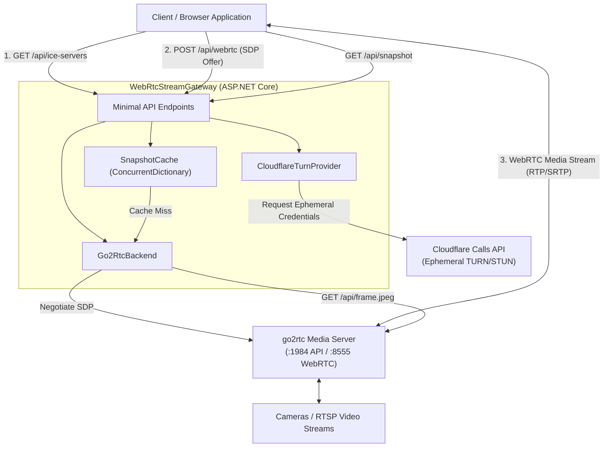

# WebRtcStreamGateway

[](LICENSE)
[](https://dotnet.microsoft.com/)

A lightweight, high-performance ASP.NET Core gateway and reverse proxy designed to bridge client applications (web frontends, mobile clients, dashboards) with a [go2rtc](https://github.com/AlexxIT/go2rtc) media streaming server.

`WebRtcStreamGateway` decouples client applications from direct access to internal media servers, offering WebRTC signaling negotiation, on-demand cached snapshot extraction, dynamic ephemeral STUN/TURN credential provisioning via Cloudflare Calls, and health monitoring.

---

## Table of Contents

- [Features](#features)
- [Architecture](#architecture)
- [Project Structure](#project-structure)
- [Ways to Run the Application](#ways-to-run-the-application)
  - [1. Docker Compose (Recommended)](#1-docker-compose-recommended)
  - [2. Standalone Docker Container](#2-standalone-docker-container)
  - [3. Local .NET CLI / Development](#3-local-net-cli--development)
- [Client Integration Guide](#client-integration-guide)
  - [Option 1: Zero-JS iFrame Embed (Recommended)](#option-1-zero-js-iframe-embed-recommended)
  - [Option 2: `<webrtc-stream>` Web Component](#option-2-webrtc-stream-web-component)
  - [Option 3: JavaScript SDK (`WebRtcStreamPlayer`)](#option-3-javascript-sdk-webrtcstreamplayer)
  - [Option 4: Interactive Developer Portal & Playground](#option-4-interactive-developer-portal--playground)
  - [Option 5: Low-Level Vanilla WebRTC API](#option-5-low-level-vanilla-webrtc-api)
  - [Poster & Snapshot Integration](#poster--snapshot-integration)
- [API Reference](#api-reference)
  - [GET /embed](#get-embed)
  - [GET /webrtc-stream.js](#get-webrtc-streamjs)
  - [POST /api/webrtc](#post-apiwebrtc)
  - [GET /api/snapshot](#get-apisnapshot)
  - [GET /api/ice-servers](#get-apiice-servers)
  - [GET /api/streams](#get-apistreams)
  - [GET /health](#get-health)
- [Configuration](#configuration)
- [Testing](#testing)
- [License](#license)

---

## Features

- **WebRTC SDP Offer/Answer Negotiation**: Proxies WebRTC session descriptions directly to `go2rtc`, enabling low-latency video feeds (RTSP, H.264, H.265) in modern browsers.
- **Drop-In Client Integration**: Zero-boilerplate integration options including a hosted `<iframe>` player (`/embed`), autonomous `<webrtc-stream>` Web Component, and programmatic JavaScript SDK (`webrtc-stream.js`).
- **Dynamic Cloudflare Calls TURN Integration**: Generates short-lived, ephemeral STUN/TURN credentials using the Cloudflare Calls TURN API with automatic cache invalidation and fallback to configured static STUN/TURN servers.
- **Snapshot Extraction & Caching**: Serves live JPEG frames on demand with thread-safe, in-memory caching to minimize strain on underlying camera hardware and `go2rtc`.
- **Stream Discovery**: Exposes active streams discovered from `go2rtc` alongside configured default stream names.
- **Health Checks & Monitoring**: Inspects connectivity to the backend media server and checks Cloudflare credential configuration status.
- **CORS Enabled**: Pre-configured cross-origin resource sharing to support web clients hosted on separate domains or ports.
- **Clean Architecture & DDD Principles**: Clear separation between Domain models/abstractions and Infrastructure service implementations.

---

## Architecture

The gateway acts as an intermediary between browser/mobile clients, the `go2rtc` media server, and external ICE providers:



---

## Project Structure

```text
WebRtcStreamGateway/
├── Dockerfile                                 # Multi-stage container build
├── docker-compose.yml                         # Ready-to-run gateway + go2rtc stack
├── WebRtcStreamGateway.sln                    # Solution file
├── src/
│   └── WebRtcStreamGateway/
│       ├── Domain/                            # Domain entities and contracts
│       │   ├── IIceServerProvider.cs          # Interface for fetching ICE/TURN servers
│       │   ├── IMediaBackend.cs               # Interface for go2rtc interaction
│       │   ├── ISnapshotCache.cs              # Interface for in-memory snapshot cache
│       │   └── Models/
│       │       ├── GatewayHealth.cs
│       │       ├── IceServer.cs
│       │       ├── IceServerResponse.cs
│       │       ├── SdpAnswer.cs
│       │       ├── StreamsResponse.cs
│       │       └── WebRtcOfferRequest.cs
│       ├── Infrastructure/                    # External service implementations
│       │   ├── CloudflareTurnProvider.cs      # Cloudflare Calls TURN integration
│       │   ├── GatewayOptions.cs              # Strongly typed options
│       │   ├── Go2RtcBackend.cs               # go2rtc HTTP client backend
│       │   └── SnapshotCache.cs               # In-memory thread-safe cache
│       ├── Properties/
│       │   └── launchSettings.json
│       ├── appsettings.json
│       ├── appsettings.Development.json
│       └── Program.cs                         # Application entrypoint & Minimal APIs
└── tests/
    └── WebRtcStreamGateway.Tests/             # Unit and integration test suite
        ├── UnitTest1.cs
        ├── WebRtcStreamGatewayTests.cs
        └── WebRtcStreamGateway.Tests.csproj
```

---

## Ways to Run the Application

### 1. Docker Compose (Recommended)

The repository provides a `docker-compose.yml` file that orchestrates both the `WebRtcStreamGateway` and an official `go2rtc` container.

1. **(Optional) Configure Cloudflare TURN Credentials**:
   Set environment variables or create a `.env` file in the repository root:
   ```env
   CLOUDFLARE_TURN_KEY_ID=your_turn_key_id
   CLOUDFLARE_API_TOKEN=your_cloudflare_api_token
   CLOUDFLARE_TTL_SECONDS=3600
   CLOUDFLARE_ENABLED=true
   ```

2. **Launch the stack**:
   ```bash
   docker compose up -d
   ```

3. **Verify the services**:
   - Gateway API: `http://localhost:5000/health`
   - go2rtc Web Interface: `http://localhost:1984`
   - RTSP streaming port: `8554`
   - WebRTC UDP/TCP port: `8555`

To shut down the stack:
```bash
docker compose down
```

---

### 2. Standalone Docker Container

If you already have a running `go2rtc` instance on your network or host:

1. **Build the container image**:
   ```bash
   docker build -t webrtc-stream-gateway .
   ```

2. **Run the container**:
   ```bash
   docker run -d \
     --name webrtc-stream-gateway \
     -p 5000:5000 \
     -e Go2Rtc__BaseUrl=http://host.docker.internal:1984 \
     -e Go2Rtc__DefaultStream=octocamrtc \
     -e Cloudflare__TurnKeyId=your_key_id \
     -e Cloudflare__ApiToken=your_token \
     webrtc-stream-gateway
   ```

---

### 3. Local .NET CLI / Development

To develop or debug locally:

#### Prerequisites
- [.NET 10.0 SDK](https://dotnet.microsoft.com/download)
- A running [go2rtc](https://github.com/AlexxIT/go2rtc) instance (defaults to `http://localhost:1984`)

#### Steps
1. **Restore dependencies**:
   ```bash
   dotnet restore
   ```

2. **Build the solution**:
   ```bash
   dotnet build
   ```

3. **Run the gateway**:
   ```bash
   dotnet run --project src/WebRtcStreamGateway
   ```
   By default, the application listens on `http://localhost:5241` and `https://localhost:7247` in development mode, or `http://+:5000` in production.

4. **Verify health**:
   ```bash
   curl http://localhost:5241/health
   ```

---

## Client Integration Guide

`WebRtcStreamGateway` provides multiple client integration tiers ranging from a 1-line zero-JavaScript `<iframe>` embed to direct DOM Web Components and low-level WebRTC APIs.

---

### Option 1: Zero-JS iFrame Embed (Recommended)

The easiest way to integrate a live stream into any web application, dashboard, or CMS without writing or bundling any JavaScript. The gateway hosts a fully responsive player complete with poster fallback, live connection status badges, controls, error recovery, and auto-reconnection:

```html
<iframe
  src="http://localhost:5000/embed?stream=octocamrtc"
  width="640"
  height="360"
  allow="autoplay; fullscreen"
  style="border: 0; border-radius: 8px; overflow: hidden;"
  loading="lazy">
</iframe>
```

#### Query Parameters

| Parameter | Type | Default | Description |
| :--- | :--- | :--- | :--- |
| `stream` | `string` | Configured default | Target stream name registered in `go2rtc`. |
| `autoplay` | `boolean` | `true` | Automatically starts playback on load. |
| `muted` | `boolean` | `true` | Mutes audio (required by modern browsers for unprompted autoplay). |
| `controls` | `boolean` | `true` | Displays player controls bar (play/pause, mute, snapshot, fullscreen). |
| `poster` | `boolean` | `true` | Shows live cached snapshot from `/api/snapshot` while connecting. |
| `fit` | `contain \| cover` | `contain` | CSS `object-fit` mode for video stream. |
| `reconnect` | `boolean` | `true` | Automatically attempts exponential backoff reconnection on disconnection. |
| `gateway` | `string` | Same-origin | Base URL of the gateway (if hosting the iframe page from a different domain). |

#### Parent Window `postMessage` API

The embedded iframe communicates bidirectionally with the host page via standard `window.postMessage`:

```javascript
const iframe = document.querySelector('iframe');

// Send commands to player
iframe.contentWindow.postMessage({ action: 'play' }, '*');
iframe.contentWindow.postMessage({ action: 'pause' }, '*');
iframe.contentWindow.postMessage({ action: 'reconnect' }, '*');
iframe.contentWindow.postMessage({ action: 'setStream', stream: 'front_door' }, '*');
iframe.contentWindow.postMessage({ action: 'mute' }, '*');
iframe.contentWindow.postMessage({ action: 'unmute' }, '*');

// Listen to player events from iframe
window.addEventListener('message', (event) => {
  if (event.data?.source === 'webrtc-stream-gateway') {
    console.log('Player event:', event.data.event, event.data);
  }
});
```

---

### Option 2: `<webrtc-stream>` Web Component

If you want the video element integrated directly into your DOM (e.g. inside a React, Vue, Angular, or standard HTML app) without an iframe, include the lightweight drop-in script:

```html
<!-- 1. Include script once -->
<script src="http://localhost:5000/webrtc-stream.js"></script>

<!-- 2. Drop the custom element anywhere in your layout -->
<webrtc-stream
  gateway="http://localhost:5000"
  stream="octocamrtc"
  autoplay
  muted
  controls
  poster>
</webrtc-stream>
```

#### Custom Element Methods & Events

The `<webrtc-stream>` element utilizes Shadow DOM for style isolation and exposes DOM properties and methods:

```javascript
const playerEl = document.querySelector('webrtc-stream');

// Methods
playerEl.play();
playerEl.pause();
playerEl.reconnect();
playerEl.captureSnapshot(); // Returns Promise<Blob>

// Events
playerEl.addEventListener('webrtc:connected', (e) => console.log('Stream connected:', e.detail.stream));
playerEl.addEventListener('webrtc:disconnected', () => console.log('Stream disconnected'));
playerEl.addEventListener('webrtc:error', (e) => console.error('Stream error:', e.detail));
playerEl.addEventListener('webrtc:statuschange', (e) => console.log('Status changed:', e.detail.status));
```

---

### Option 3: JavaScript SDK (`WebRtcStreamPlayer`)

For custom user interfaces or single-page apps wanting programmatic control without the WebRTC boilerplate:

```html
<script src="http://localhost:5000/webrtc-stream.js"></script>

<video id="myVideo" autoplay playsinline muted></video>

<script>
  const player = new WebRtcStreamPlayer({
    gatewayUrl: 'http://localhost:5000',
    stream: 'octocamrtc',
    videoElement: document.getElementById('myVideo'),
    autoplay: true,
    muted: true,
    autoReconnect: true,
    onStatusChange: (status, detail) => console.log('Status:', status, detail),
    onError: (err) => console.error('Stream error:', err)
  });

  player.start();
</script>
```

Or with modern ES Modules:
```javascript
import { WebRtcStreamPlayer } from 'http://localhost:5000/webrtc-stream.esm.js';
```

---

### Option 4: Interactive Developer Portal & Playground

Visit the root URL of the running gateway in your browser:

```text
http://localhost:5000/
```

The portal provides:
- Live streaming player preview
- Real-time gateway and backend health monitor
- Stream switcher populated dynamically from `/api/streams`
- Visual code generator with one-click copyable snippets for `<iframe>`, `<webrtc-stream>`, and the JavaScript SDK.

---

### Option 5: Low-Level Vanilla WebRTC API

Below is a complete vanilla JavaScript example showing how to connect to the gateway and display a live stream in an HTML `<video>` element using raw browser WebRTC APIs:

```html
<!DOCTYPE html>
<html lang="en">
<head>
  <meta charset="UTF-8" />
  <title>WebRTC Stream</title>
</head>
<body>
  <video id="remoteVideo" autoplay playsinline controls muted style="max-width: 100%;"></video>

  <script>
    const GATEWAY_URL = "http://localhost:5000";
    const STREAM_NAME = "octocamrtc"; // Replace with your stream name

    async function startStream() {
      // 1. Fetch ICE servers (STUN/TURN) from the gateway
      const iceResponse = await fetch(`${GATEWAY_URL}/api/ice-servers`);
      const { iceServers } = await iceResponse.json();

      // 2. Initialize the RTCPeerConnection
      const pc = new RTCPeerConnection({ iceServers });

      // 3. Attach incoming video track to the video element
      pc.ontrack = (event) => {
        const videoElement = document.getElementById("remoteVideo");
        if (videoElement.srcObject !== event.streams[0]) {
          videoElement.srcObject = event.streams[0];
        }
      };

      // 4. Request receive-only video and audio transceivers
      pc.addTransceiver("video", { direction: "recvonly" });
      pc.addTransceiver("audio", { direction: "recvonly" });

      // 5. Create local SDP offer and wait for ICE gathering
      const offer = await pc.createOffer();
      await pc.setLocalDescription(offer);

      await new Promise((resolve) => {
        if (pc.iceGatheringState === "complete") {
          resolve();
        } else {
          const checkState = () => {
            if (pc.iceGatheringState === "complete") {
              pc.removeEventListener("icegatheringstatechange", checkState);
              resolve();
            }
          };
          pc.addEventListener("icegatheringstatechange", checkState);
        }
      });

      // 6. Post SDP offer to the gateway
      const negotiateResponse = await fetch(`${GATEWAY_URL}/api/webrtc`, {
        method: "POST",
        headers: { "Content-Type": "application/json" },
        body: JSON.stringify({
          sdp: pc.localDescription.sdp,
          type: "offer",
          stream: STREAM_NAME
        })
      });

      if (!negotiateResponse.ok) {
        throw new Error(`SDP negotiation failed: HTTP ${negotiateResponse.status}`);
      }

      const answer = await negotiateResponse.json();

      // 7. Apply remote SDP answer
      await pc.setRemoteDescription(new RTCSessionDescription({
        type: answer.type,
        sdp: answer.sdp
      }));
    }

    startStream().catch(console.error);
  </script>
</body>
</html>
```

### Poster & Snapshot Integration

Fetch a live JPEG frame snapshot for poster frames, thumbnail generation, or low-bandwidth views:

```html
<!-- Display snapshot from default stream -->


<!-- Display snapshot from specific stream -->

```

Snapshots are automatically cached in memory according to `SnapshotCache:DefaultTtlSeconds` (default: 5 seconds) to avoid redundant decoding requests to the media backend.

---

## API Reference

### GET /embed

Serves the standalone, embeddable HTML5 WebRTC stream player designed for `<iframe>` embedding or full-window viewing.

- **Query Parameters**:
  - `stream` *(string, optional)*: Stream name to play. Defaults to the gateway's configured default stream.
  - `autoplay` *(boolean, optional, default: `true`)*: Whether to begin playback automatically.
  - `muted` *(boolean, optional, default: `true`)*: Whether audio is muted by default.
  - `controls` *(boolean, optional, default: `true`)*: Whether to render player controls overlay.
  - `poster` *(boolean, optional, default: `true`)*: Whether to render snapshot poster while connecting.
  - `fit` *(string, optional, default: `contain`)*: Video object-fit mode (`contain` or `cover`).
  - `reconnect` *(boolean, optional, default: `true`)*: Whether to automatically reconnect with exponential backoff on connection drop.
- **Responses**:
  - `200 OK`: `text/html; charset=utf-8`

---

### GET /webrtc-stream.js

Serves the drop-in client library and autonomous `<webrtc-stream>` Web Component.

- **Responses**:
  - `200 OK`: `application/javascript; charset=utf-8`

---

### POST /api/webrtc

Exchanges a WebRTC SDP offer from a client for an SDP answer from `go2rtc`.

- **Headers**: `Content-Type: application/json`
- **Request Body**:
  ```json
  {
    "sdp": "v=0\r\no=- ...\r\n",
    "type": "offer",
    "stream": "octocamrtc"
  }
  ```
  *(Note: `stream` is optional. If omitted, `Go2Rtc:DefaultStream` is used).*

- **Responses**:
  - `200 OK`:
    ```json
    {
      "sdp": "v=0\r\no=- ...\r\n",
      "type": "answer"
    }
    ```
  - `400 Bad Request`: If SDP offer is empty or missing.
  - `502 Bad Gateway`: If `go2rtc` is unreachable or rejects the offer.

---

### GET /api/snapshot

Retrieves a current JPEG image snapshot from the media stream.

- **Query Parameters**:
  - `stream` *(string, optional)*: Stream name to capture.
  - `src` *(string, optional)*: Alternative parameter name for stream identifier.
- **Responses**:
  - `200 OK`: Content-Type `image/jpeg` containing binary image data.
  - `503 Service Unavailable`: If backend snapshot capture fails.

---

### GET /api/ice-servers

Fetches ICE servers (STUN/TURN) for WebRTC peer connection configuration.

- **Responses**:
  - `200 OK`:
    ```json
    {
      "iceServers": [
        {
          "urls": [
            "stun:stun.cloudflare.com:3478",
            "turn:turn.cloudflare.com:3478?transport=udp"
          ],
          "username": "ephemeral_user_string",
          "credential": "ephemeral_credential_string"
        }
      ]
    }
    ```
    *Falls back to configured `FallbackIceServers` if Cloudflare is disabled or credentials cannot be retrieved.*

---

### GET /api/streams

Retrieves a list of available stream names discovered from `go2rtc`.

- **Responses**:
  - `200 OK`:
    ```json
    {
      "streams": [
        "octocamrtc",
        "cam2"
      ],
      "defaultStream": "octocamrtc"
    }
    ```

---

### GET /health

Reports the operational readiness of the gateway and its connected backends.

- **Responses**:
  - `200 OK`:
    ```json
    {
      "status": "Healthy",
      "backendReachable": true,
      "cloudflareConfigured": true,
      "checkedAt": "2026-11-02T16:00:00Z"
    }
    ```
    *Status will read `"Degraded"` if `backendReachable` is `false`.*

---

## Configuration

Settings can be specified in `appsettings.json`, `appsettings.{Environment}.json`, or overridden using standard ASP.NET Core environment variables (using double underscores `__` as section separators).

### `appsettings.json` Example

```json
{
  "Logging": {
    "LogLevel": {
      "Default": "Information",
      "Microsoft.AspNetCore": "Warning"
    }
  },
  "AllowedHosts": "*",
  "Cloudflare": {
    "TurnKeyId": "",
    "ApiToken": "",
    "TtlSeconds": 3600,
    "Enabled": true,
    "FallbackIceServers": [
      {
        "urls": [ "stun:stun.cloudflare.com:3478" ]
      }
    ]
  },
  "Go2Rtc": {
    "BaseUrl": "http://localhost:1984",
    "DefaultStream": "octocamrtc",
    "TimeoutSeconds": 10
  },
  "SnapshotCache": {
    "DefaultTtlSeconds": 5
  }
}
```

### Environment Variables

| Variable | Description | Default |
|---|---|---|
| `Go2Rtc__BaseUrl` | URL to the `go2rtc` REST API | `http://localhost:1984` |
| `Go2Rtc__DefaultStream` | Default stream identifier to use if not provided in requests | `octocamrtc` |
| `Go2Rtc__TimeoutSeconds` | HTTP client timeout for `go2rtc` requests | `10` |
| `Cloudflare__TurnKeyId` | Cloudflare Calls TURN Key ID | `""` |
| `Cloudflare__ApiToken` | Cloudflare API Bearer token | `""` |
| `Cloudflare__TtlSeconds` | Credential lifetime requested from Cloudflare (clamped between 60s and 172800s) | `3600` |
| `Cloudflare__Enabled` | Whether Cloudflare TURN dynamic credential lookup is enabled | `true` |
| `SnapshotCache__DefaultTtlSeconds` | Snapshot cache duration in seconds | `5` |

---

## Testing

The solution includes an automated test suite located in `tests/WebRtcStreamGateway.Tests/` utilizing **xUnit**, **Moq**, and **Microsoft.AspNetCore.Mvc.Testing** (`WebApplicationFactory`).

Run the test suite using the .NET CLI:

```bash
dotnet test
```

---

## License

This project is licensed under the [MIT License](LICENSE).
